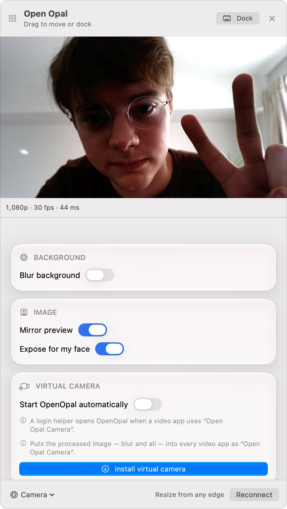

# Open Opal

A native macOS app for the Opal C1 webcam. Opal discontinued the C1 and its
Composer software; Open Opal keeps the camera working, and adds a few things.



- Full camera control: exposure, focus, white balance, image tuning, 4K/1080p/720p
- Background blur
- A virtual camera, **Open Opal Camera**, for Zoom, Meet, FaceTime and the rest
- Lives in the menu bar; drag to float, then release near the menu bar to dock
- About 45 ms from lens to screen

## Fork branches

`main` starts from upstream and accepts individually reviewed and tested PRs.
`develop` combines the feature branches for integration testing, including the
previous `main` history. Do not merge `develop` wholesale into `main`.

The detachable panel and filters use different preview APIs in their standalone
PRs; `develop` contains the combined `RenderedFrame` integration. Builds and
synthetic rendering/conversion checks pass, but combined hardware behavior,
signing, and receiving-app delivery still need testing.

## Install

Download the latest DMG from [Releases](https://github.com/alii/open-opal/releases)
and drag Open Opal to Applications. Click the lens icon in the menu bar to
open it, and right-click the icon to quit.

- Exposure: auto, or manual shutter and ISO, with EV compensation and AE lock
- Focus: autofocus modes, manual lens position, click anywhere to focus, optional person-based tracking and lens search limits
- White balance: presets or manual Kelvin
- Anti-banding for 50/60 Hz lighting
- Sharpness, denoise, brightness, contrast, saturation
- 4K / 1080p / 720p, up to 42 fps
- Background blur, rendered in Metal with Apple's Vision segmentation
- Optional exposure metering on your face instead of the whole frame
- 21 local Metal effects plus None, with categorized search, intensity, and
  optional effect animation; face-tracked looks use Apple's Vision landmarks
- Menu bar controls with a live preview and an icon-aligned pointer
- Drag the header to float and resize; drop near the menu bar icon to dock

The app starts in the menu bar without a Dock icon or a separate main window.
Click the camera-aperture icon to open the controls. The header button also
switches between docked and floating controls. Clicking away or pressing Escape
hides the panel without disconnecting the camera. Click the icon to reopen it.
Quit ends the camera session.

Camera controls, capture size, blur, and autofocus limits survive app restarts.
Reset All also clears saved autofocus choices. Existing saved settings inherit
defaults for fields they do not contain.

Frames are downscaled on the camera's own ISP before crossing USB, which keeps
glass-to-screen latency around 45 ms at 1080p30. The toolbar shows the live
number.

### Autofocus

“Follow face” uses the upper-middle of the segmented person's box as an estimate
of where a face is, not a face detector. It refocuses when that area's size changes
by more than 40%, with a one-second cooldown. This works best with one person
facing the camera; raised arms or multiple people can confuse the estimate.

“Limit range” restricts autofocus to the Far and Near lens positions you choose
(0–255). The limit is restored after switching from manual to automatic focus,
changing autofocus mode, or focusing on a region. Turning the limit off restores
the full 0–255 range. Exposure and other unrelated control changes do not restart
autofocus. Entering manual focus clears the tracking history immediately, so
returning to automatic focus can refocus even if the person's size has not changed.

## Building

```sh
brew install cmake ninja xcodegen
./scripts/bootstrap.sh
./scripts/fetch-models.sh
xcodegen generate
open OpenOpal.xcodeproj
```

Building needs Xcode 27. See [TECHNICAL.md](TECHNICAL.md) for details, tests,
and how the camera takeover works.

## Thanks

A huge thank you to [Jamie Dubs](https://github.com/jamiew), who added
support for first-generation IMX378 C1s, follow-face autofocus with lens range
limits, custom camera tuning files, the detachable menu bar panel, the virtual
camera format fix, readable sensor names and CI. Thanks also to
[Niek](https://github.com/Niek) for the bundling fixes, saved settings and
auto-start.

## License

MIT. Not affiliated with Opal Camera Inc. Thanks to Luxonis for DepthAI, and
to Opal for building the C1 on an open platform in the first place.
